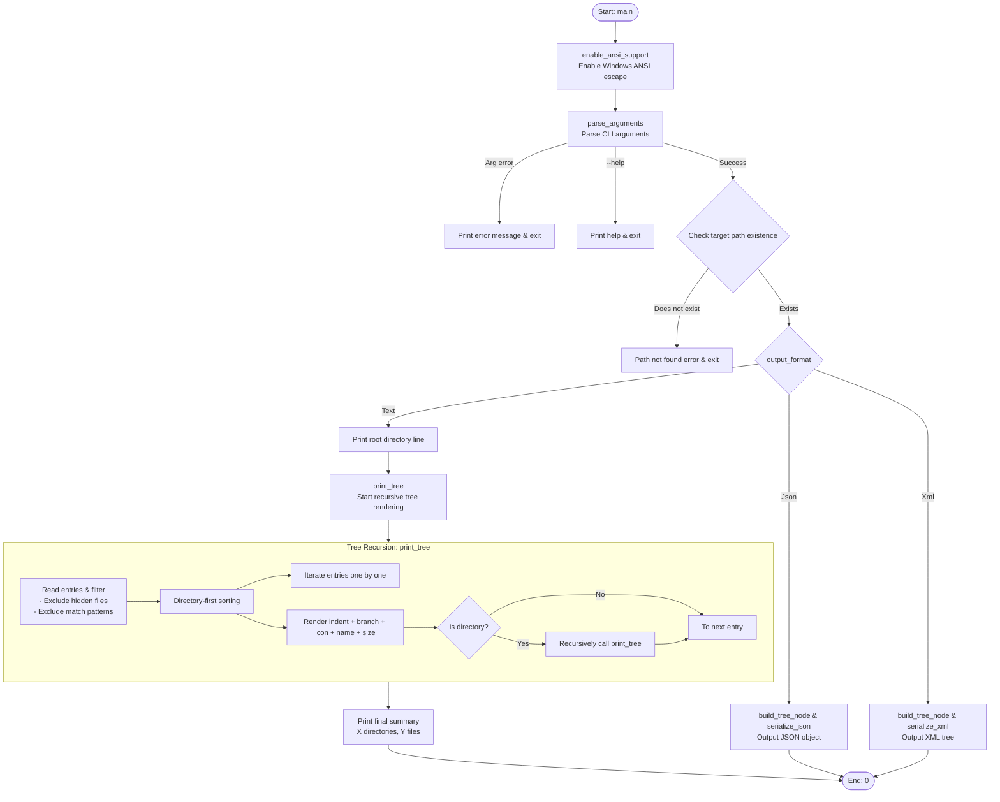
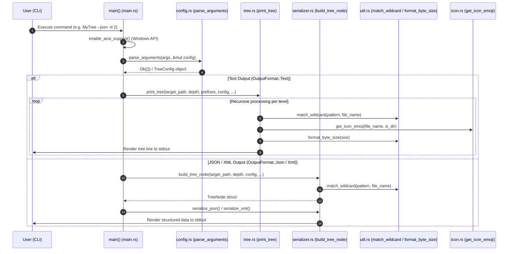
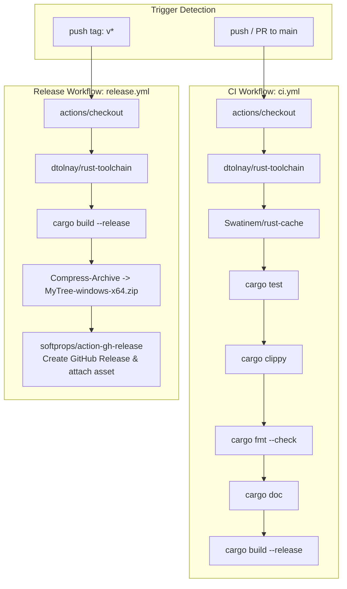

# System Diagrams (DIAGRAM.md) - MyTree

**English** | [日本語版](../ja/DIAGRAM.md)

This document visualizes the execution flow and component structure of `MyTree` using Mermaid diagrams.

---

## 1. Execution Flowchart

---

## 2. Component Inter-Data Flow Diagram

---

## 3. GitHub Actions CI/CD Workflow Diagram

