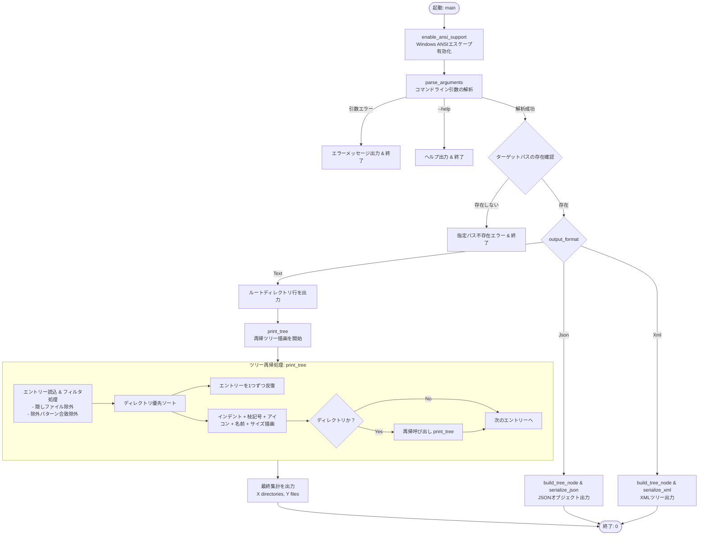
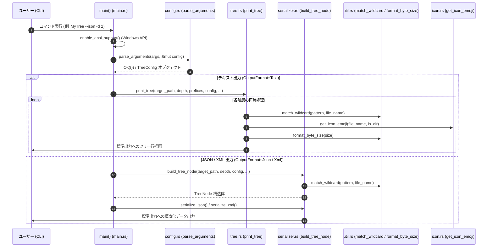
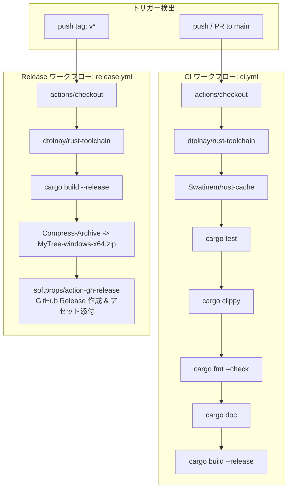

# System Diagrams (DIAGRAM.md) - MyTree

[English](../en/DIAGRAM.md) | **日本語版**

本文書では、`MyTree` の実行フローおよびコンポーネント構造を Mermaid ダイアグラムで可視化します。

---

## 1. 実行フローチャート

---

## 2. モジュール間データフロー図

---

## 3. GitHub Actions CI/CD フロー図

